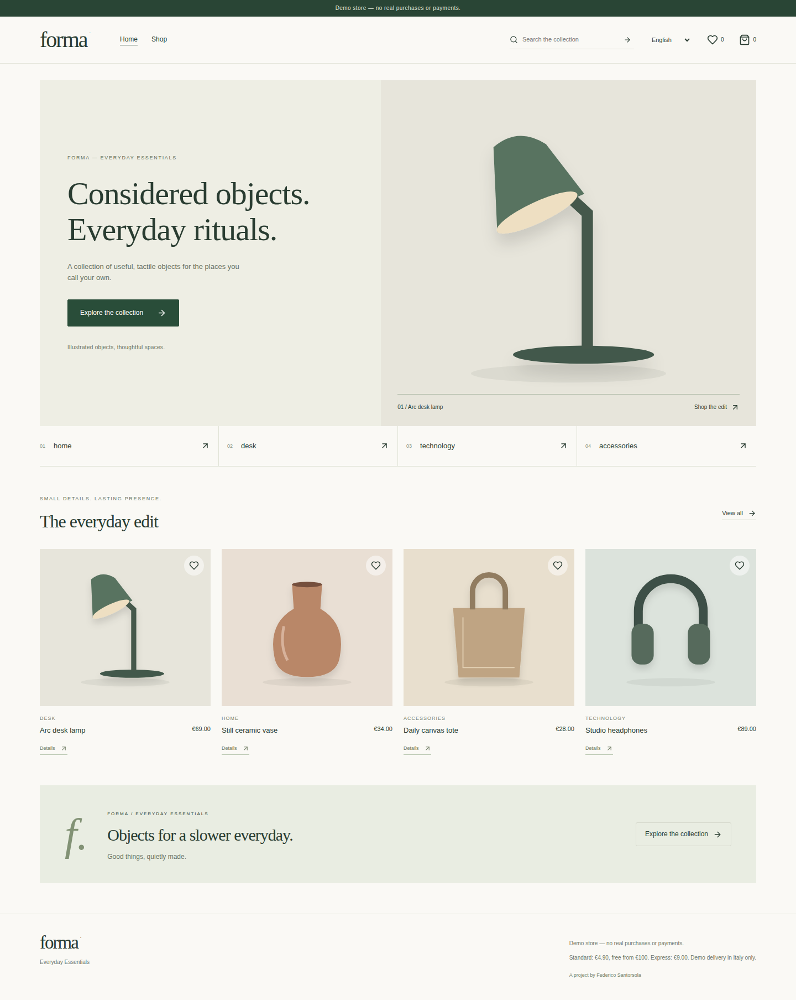
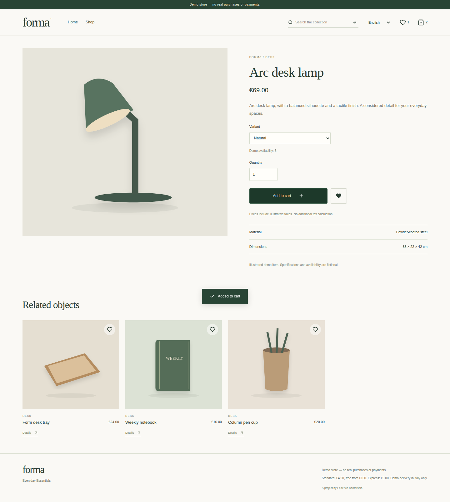
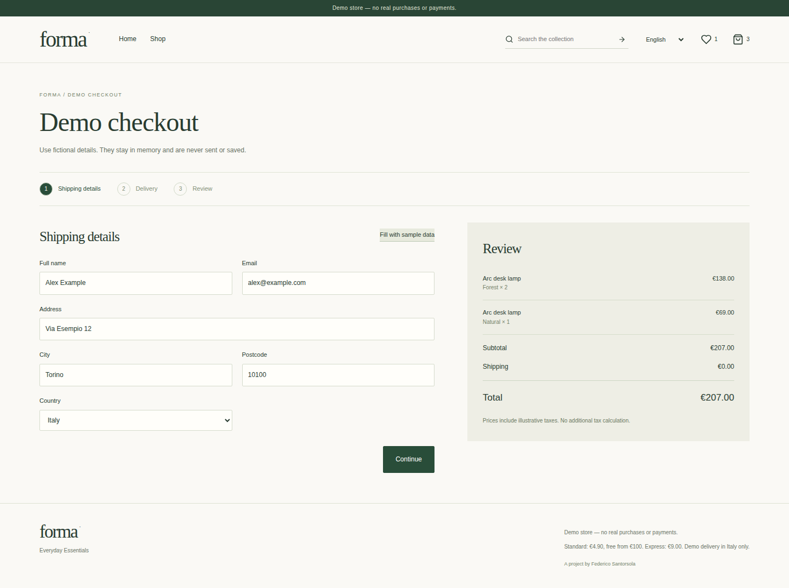
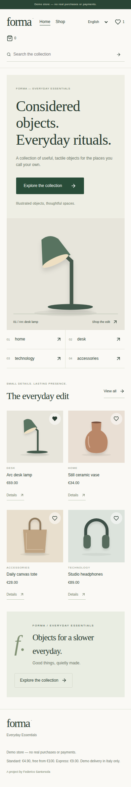

# Forma — Everyday Essentials

A bilingual demonstration store for considered objects for the home, desk and everyday life. Built with **React, TypeScript and Vite**, Forma runs entirely in the browser with a local catalogue and original product illustrations.

The interface defaults to **English**, with **Italian** available from the header. Every purchase is simulated: no payment, shipment, email, account or backend exists.



## Project overview

- Editorial home with product selection and category navigation.
- Four categories and 14 local products, each with bilingual descriptions, illustrative materials/dimensions, EUR prices, selectable variants and bounded demo stock.
- Search, category, maximum price, availability and sorting controls, with filters preserved in URLs.
- Direct product links, quantity selection, related objects from the same category and wishlist controls.
- Persistent variant-aware cart that rebuilds prices from the trusted catalogue and calculates in integer cents.
- Four-part demo order flow: shipping details, delivery, review and confirmation.
- Sample-data action using a fictional address and `alex@example.com`.
- Memory-only checkout details and order snapshot; printable confirmation.
- Responsive layouts, keyboard controls, visible focus, translated validation and accessible status feedback.

## Interface previews

### Product detail



### Demo checkout



### Mobile

<p align="center"></p>

These are screenshots of the implemented interface, not design mockups.

## Architecture

| Area           | Implementation                                                                    |
| -------------- | --------------------------------------------------------------------------------- |
| Catalogue      | Typed local JSON with stable IDs/slugs, bilingual content and variant stock       |
| Commerce rules | Pure TypeScript normalisation, quantities, integer-cent totals and delivery rules |
| Persistence    | Namespaced localStorage with in-memory fallback                                   |
| Interface      | React 18, TypeScript, Lucide, local SVG artwork                                   |
| Navigation     | Query parameters, compatible with static hosting                                  |
| Checkout       | In-memory fields and immutable order snapshot with submission guard               |
| Verification   | Vitest, Playwright, TypeScript and ESLint                                         |

```text
src/catalog.json ── trusted products / prices / variants
        │
        ▼
Normalised cart + local wishlist
        │
        ▼
Memory-only demo checkout ── order snapshot ── clear cart
```

## Requirements and startup

Use **Node.js 22.22.1 or newer** and npm. `.nvmrc` records the tested version. No `.env` file, API key or external service is needed.

From the application directory:

```bash
npm ci
npm run dev
```

Open **http://localhost:3022**. Vite prints an alternative if the port is occupied. To choose a port: `npm run dev -- --port 3030`.

## Try the demo

1. Open **Shop**, search or filter the collection, then select a product.
2. Choose Natural or Forest, set a quantity and add the item to the cart. Availability is fictional and clearly labelled; unavailable variants cannot be purchased.
3. Save objects to the wishlist and reopen their product pages.
4. Change quantities in the cart, then proceed to the demo checkout.
5. Submit an empty form to inspect validation, or use **Fill with sample data**.
6. Select delivery, review the order and confirm the simulation.
7. Print the summary through the browser. No real transaction occurs.

Language preference, cart and wishlist persist locally. Changing language retains the current cart, wishlist and checkout fields. Currency always remains EUR.

## Cart and persistence

Cart rows are identified by product ID and variant ID. Saved prices, names and arbitrary extra fields are ignored; prices are rebuilt from the catalogue. Unknown products, missing/unavailable variants and invalid quantities are removed. Duplicate rows are merged and stock limits enforced.

The previous `fs-shop22-cart` product format has no reliable variant mapping and is deliberately not imported. The new cart uses `forma:cart`; legacy values cannot influence totals. Corrupt persistence falls back to an empty cart. If localStorage is unavailable, the app displays a warning and still supports the current simulation in memory.

Only cart IDs/quantities, wishlist IDs and language are persisted. Shipping details and confirmation snapshots are never placed in storage, the URL or network requests. A reload loses the in-memory order summary and shows an explanatory state; no server-side order history is implied.

## Demo shipping and pricing

Delivery is simulated **only within Italy**, so postcode validation requires exactly five digits and is not presented as a worldwide rule.

- Standard: **€4.90**, free when the merchandise subtotal reaches **€100**.
- Express: **€9.00**, independent of the subtotal.
- Demonstration prices already include illustrative taxes; no additional tax calculation occurs.

The checkout never asks for card information. Product stock is not a live inventory system. The final snapshot is created before clearing the cart and an in-memory guard prevents duplicate confirmation.

## Tests and checks

```bash
npm run typecheck
npm run lint
npm test
npm run build
```

With the production preview running in a second terminal:

```bash
npx playwright install chromium
npm test -- --browser
```

`npm test -- --all --browser` runs the complete local pipeline. The browser script uses `/usr/bin/google-chrome` when available, otherwise Playwright Chromium. A custom preview can be selected with `--url=http://localhost:3022/`.

Tests cover cent arithmetic, variant identity, stock limits, shipping, corrupted/legacy persistence, filtering and sorting, translations, validation, order snapshots and duplicate submission. Browser checks exercise the purchase flow, language, URL selections, reloads and mobile layout. See [verification notes](docs/VERIFICATION.md).

## Build and static hosting

```bash
npm run build
npm run preview
```

Stop the development server first if it uses the same port. The output is `dist/`; publish its contents to a static host. Do not open the HTML through `file://`.

For a GitHub Pages repository prefix:

```bash
BASE_PATH=/forma-store/ npm run build
npm run preview -- --base=/forma-store/
```

Product pages and filters use query parameters, so direct links work without SPA route rewrites. Local illustration paths respect the Vite base URL. CI validates installation, typecheck, lint, tests and build without deploying. No public demo or remote repository URL is invented here.

## Repository structure

```text
src/
  catalog.json       Local bilingual demonstration catalogue
  domain.ts          Types, pricing, stock, filters, URL state and order rules
  storage.ts         Persistence, legacy exclusion and memory fallback
  i18n.ts            Translations and EUR formatting
  shared.tsx         Shared product cards and image paths
  App.tsx            Home, catalogue, product, wishlist, cart and navigation
  Checkout.tsx       Shipping fields, delivery, review and confirmation guard
  core.test.ts       Unit tests for commerce rules and persistence
public/products/     Original local SVG illustrations
scripts/             Check runner and browser tests
docs/screenshots/    Actual interface screenshots
.github/workflows/   CI without automatic deployment
```

## Scope, assets and attribution

The catalogue, specifications, variants, inventory, shipping and checkout are fictional. No fabricated reviews, customer counts or testimonials are included. There is no authentication, admin area, real payment processing or remote data collection.

Commerce.js and Stripe integrations from inactive code have been removed. `.env`, dependency folders, ZIP files, IDE files, old lockfile archives and build output are excluded. The reviewed baseline commit includes only explicitly selected active files, not the entire original directory.

See [ATTRIBUTIONS.md](ATTRIBUTIONS.md) for local artwork and dependency rights. No project-wide open-source licence has been selected.

## Author

[Federico Santorsola](https://github.com/Frero0)
